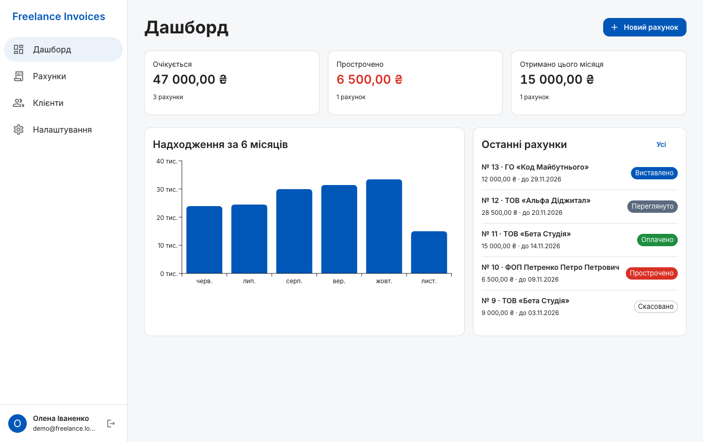
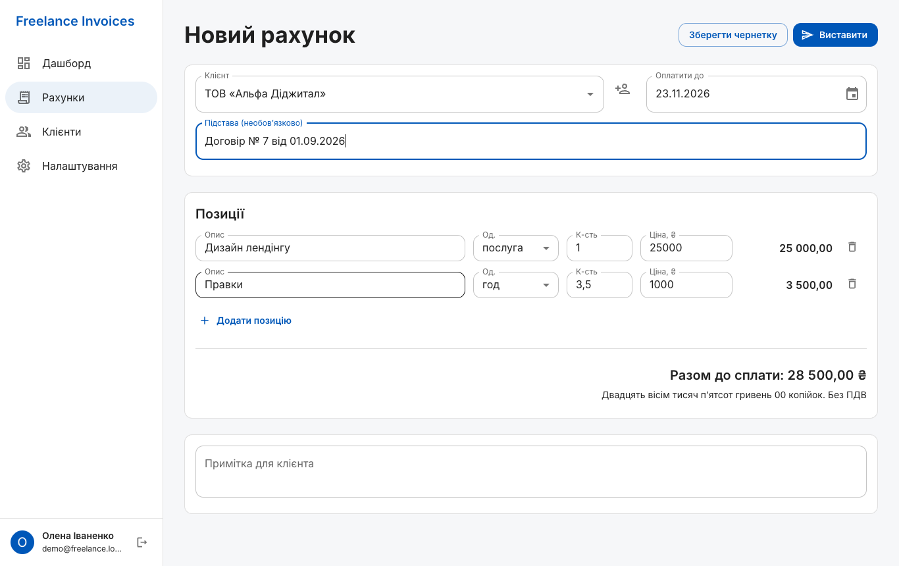
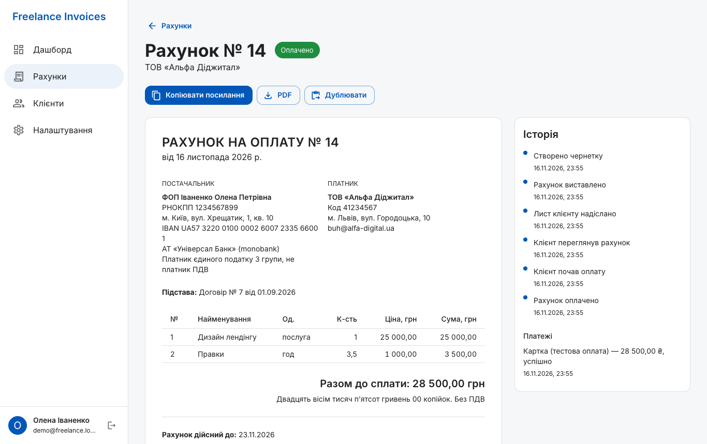
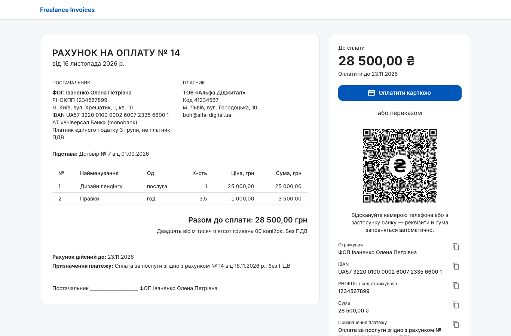
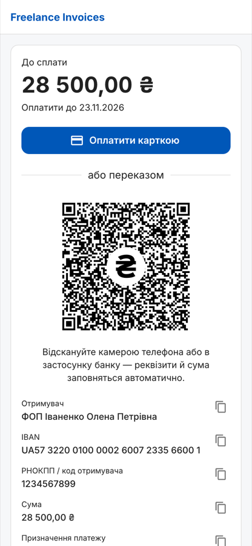
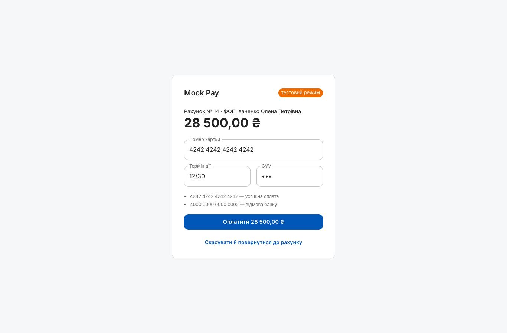
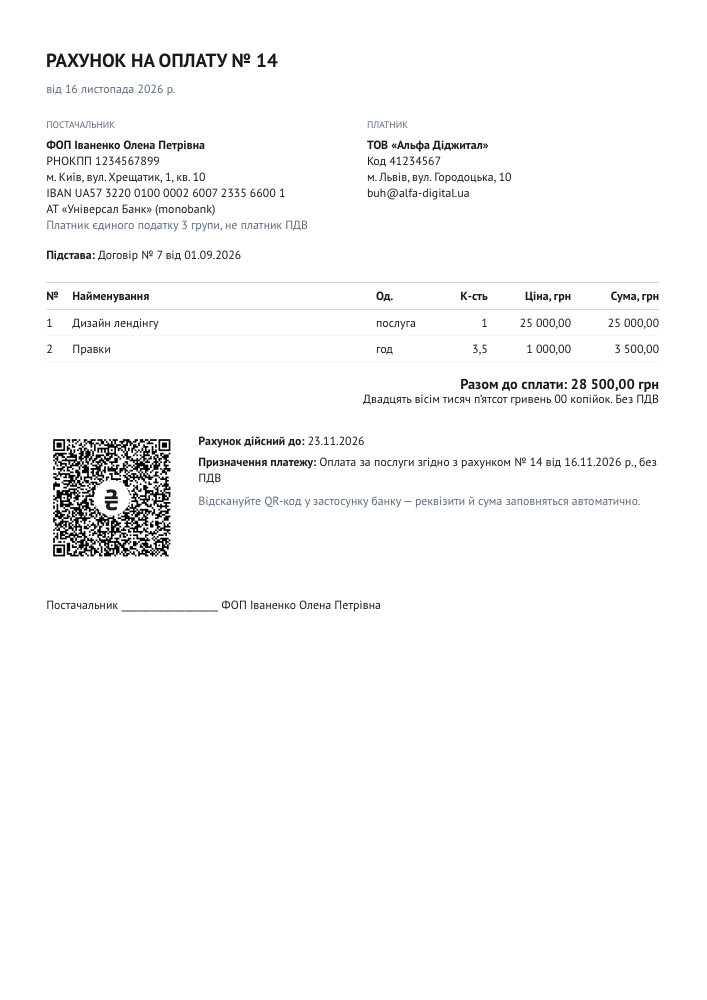
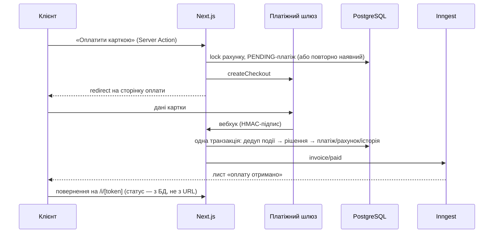

# Freelance Invoices

Рахунки й оплати для фрилансерів-ФОП. Фрилансер виставляє рахунок з усіма реквізитами, клієнт відкриває посилання
й оплачує карткою або QR-кодом НБУ у застосунку свого банку. Статуси, листи й нагадування — автоматично.



## Що вміє

**Фрилансер**
- реквізити ФОП з перевіркою IBAN (mod-97) і РНОКПП (контрольна цифра), підказка банку за МФО;
- клієнти (ЄДРПОУ/РНОКПП, email, архів);
- редактор рахунку: позиції, кількість з комою, живий підсумок і **сума прописом**, підстава (договір);
- виставлення з наскрізною нумерацією без пропусків і «замороженими» реквізитами;
- історія кожного рахунку: створено → виставлено → лист надіслано → клієнт переглянув → оплачено;
- ручна позначка «Оплачено» (переказ на IBAN), скасування, дублювання, «Нагадати»;
- дашборд: очікується / прострочено / отримано цього місяця, графік надходжень за 6 місяців.

**Клієнт** (без реєстрації)
- сторінка рахунку за посиланням — документ, PDF, реквізити з кнопками копіювання;
- **QR-код НБУ** (формат 002) — банківський застосунок сам заповнить отримувача, IBAN, суму й призначення;
- оплата карткою: тестовий Mock-шлюз без ключів або monobank Acquiring (sandbox);
- листи: рахунок, нагадування до й після терміну, підтвердження оплати.

## Швидкий старт

Потрібні Node 24 (`.nvmrc`), pnpm і Docker.

```bash
cp .env.example .env
pnpm install
pnpm bootstrap   # docker compose (postgres :5433 · mailpit :8025 · inngest :8288) + міграції + демо-дані
pnpm dev         # http://localhost:3000
```

| Що | Де |
|---|---|
| Застосунок | http://localhost:3000 — кнопка «Демо-вхід» або `demo@freelance.local` / `demo12345` |
| Листи (Mailpit) | http://localhost:8025 |
| Фонові задачі (Inngest Dev Server) | http://localhost:8288 |

`pnpm db:seed` перестворює демо-акаунт з початковими даними.

## Як спробувати

1. «Демо-вхід» → дашборд, рахунки й клієнти з демо-даними.
2. «Новий рахунок» → клієнт, позиції → «Виставити». Лист клієнту з’явиться в Mailpit.
3. «Копіювати посилання» → відкрийте його в інкогніто чи на телефоні — так рахунок бачить клієнт.
4. Оплата:
   - **карткою** (тестовий шлюз): `4242 4242 4242 4242` — успіх, `4000 0000 0000 0002` — відмова,
     `4000 0000 0000 0101` — списано на 1 коп. менше (розбіжність суми);
   - **переказом**: QR-код НБУ скануються застосунком банку; фрилансер позначає оплату вручну.
5. Статус «Оплачено» ставить лише підписаний вебхук — у кабінеті видно оплату, історію й лист «Вам оплатили».
6. Нагадування: `REMINDER_DEMO_MODE=true pnpm dev` — нагадування прийдуть через 1 і 2 хвилини після виставлення
   (замість «за день до терміну» й «після прострочення»). Оплата чи скасування рахунку скасовує їх автоматично.

### Оплата через monobank (sandbox)

За замовчуванням працює тестовий шлюз без ключів. Щоб спробувати справжній еквайринг monobank у тестовому режимі:

1. Отримайте тестовий токен на https://api.monobank.ua/ (вхід через застосунок monobank).
2. У `.env`: `PAYMENT_PROVIDER=monobank`, `MONOBANK_TOKEN=<токен>`; перезапустіть `pnpm dev`.
3. «Оплатити карткою» відкриє сторінку оплати monobank; після повернення статус звіряється з monobank
   (`GET /api/merchant/invoice/status`) — це працює локально без публічного URL.
4. Щоб отримувати ще й вебхуки, потрібен публічний https-тунель до `localhost:3000`
   (наприклад, `cloudflared tunnel --url http://localhost:3000`) і `PUBLIC_URL=<адреса тунелю>`.
   Підпис вебхука перевіряється ECDSA-ключем з `/api/merchant/pubkey`.

## Скриншоти

| Редактор рахунку | Рахунок у кабінеті |
|---|---|
|  |  |

| Сторінка для клієнта | Телефон | Тестовий платіжний шлюз |
|---|---|---|
|  |  |  |

PDF рахунку з QR-кодом НБУ:



## Архітектура

| Шар | Технології |
|---|---|
| Застосунок | Next.js 16 (App Router, Server Actions, Route Handlers), React 19, TypeScript strict |
| UI | MUI v9, MUI X Date Pickers і Charts |
| Дані | PostgreSQL 17, Prisma 7 (`@prisma/adapter-pg`) |
| Автентифікація | Better Auth (email + пароль) |
| Фонові задачі | Inngest (листи, нагадування з `sleepUntil` і `cancelOn`) |
| Пошта | Nodemailer + React Email → Mailpit |
| Документи | `@react-pdf/renderer` (PT Sans), власний генератор QR НБУ |
| Валідація й тести | Zod 4, Vitest (unit + integration), GitHub Actions |

```
src/
├─ app/            маршрути: (auth), (app) — кабінет, i/[token] — сторінка клієнта, pay/mock, api/*
├─ features/       auth · profile · clients · invoices · payments · public · dashboard · notifications
│                  кожна: actions.ts (Server Actions) → service.ts (бізнес-логіка) → queries.ts
├─ lib/            чисті функції з тестами: гроші, сума прописом, IBAN, РНОКПП, QR НБУ, дати, правила оплати
├─ inngest/        клієнт, типізовані події, фонові функції
├─ emails/ · pdf/  шаблони листів і PDF
└─ generated/      Prisma Client (генерується, не в git)
```

### Потік оплати карткою



## Ключові рішення

- **Гроші — цілі копійки (`Int`)**, кількість — у сотих. Жодного float у розрахунках (`0,1 + 0,2` рахується точно).
- **«Оплачено» — лише з перевіреного вебхука** або ручної позначки, ніколи з redirect чи параметра URL.
- **Ідемпотентні вебхуки:** запис події, блокування рахунку й зміна статусів — в одній транзакції; повторна
  чи паралельна доставка не дублює оплату; застарілі події відкидаються; статуси платежу рухаються лише вперед.
- **Крайові випадки оплати** мають явну поведінку: розбіжність суми, повторна оплата вже оплаченого рахунку,
  оплата скасованого рахунку → платіж фіксується, фрилансер бачить попередження (повернути кошти).
- **Нумерація** присвоюється при виставленні атомарним інкрементом — без дублів і пропусків навіть при паралельних запитах.
- **Знімок реквізитів:** виставлений рахунок — документ; зміна профілю чи клієнта його не змінює.
- **Публічне посилання** — непередбачуваний токен, `noindex`; «переглянуто» фіксується з браузера, тож прев’ю
  посилань у месенджерах і перегляд власником не рахуються.
- **Аргументи Server Actions — недовірений ввід:** кожен id перевіряється до запиту в БД
  (`undefined` у Prisma `where` означає «без фільтра»).
- **QR НБУ, формат 002** — його читають застосунки всіх банків; реалізація звірена байт у байт з еталонним
  прикладом із Правил НБУ (постанова № 97), а тест розпізнає згенерований QR декодером попри знак гривні в центрі.
- **Inngest:** нагадування «сплять» до 10:00 за Києвом і автоматично скасовуються подією оплати чи скасування.
  Без Inngest застосунок працює — листи надсилаються синхронно.

## Тести

```bash
pnpm lint && pnpm typecheck
pnpm test              # 125 unit-тестів: гроші, сума прописом, IBAN/РНОКПП, QR НБУ, дати, правила оплати, monobank
pnpm test:integration  # 19 інтеграційних на окремій БД invoices_test (потрібен docker compose)
```

Інтеграційні тести покривають ідемпотентність вебхуків (зокрема 5 паралельних доставок однієї події),
розбіжність суми, подвійну оплату, нумерацію при паралельному виставленні, знімок реквізитів, доступ до чужих даних
і шлях monobank (перевірка ECDSA-підпису вебхука, звірка статусу) з підміненим API.
CI (GitHub Actions) запускає все це плюс production-збірку.

## Що далі

- Акти виконаних робіт після оплати; фіскальні чеки (ПРРО) для карткових оплат.
- Автозвірка переказів з банківською випискою (API банку / CSV) замість ручної позначки.
- Rate limiting публічних маршрутів і вебхуків (Redis), англомовний інвойс і USD/EUR, часткові оплати.

## Використані шаблони й ресурси

- Каркас застосунку — `create-next-app` 16.4.6.
- Шрифт PT Sans (ParaType, SIL Open Font License) для PDF — `src/pdf/fonts/OFL.txt`.
- Формат QR-коду — Правила НБУ (постанова № 97 від 19.08.2025), додаток 3.
- Обов’язкові реквізити рахунку — за матеріалами блогу Doc2Pay.

## Як використовувався AI

Проєкт зроблено з AI-асистентом Claude Code, як дозволяє умова завдання. План, архітектура й правила роботи
зафіксовані в [`CLAUDE.md`](CLAUDE.md); код писався невеликими кроками з окремим комітом на кожен.

Кожен крок перевірявся: unit- та інтеграційні тести, запити до Server Actions і вебхуків, прогін демо-сценарію
в справжньому браузері, візуальна перевірка PDF і листів. Ці перевірки впіймали реальні проблеми, які довелося
виправити: `undefined` id у Server Action, що в Prisma знімав фільтр; SSR-падіння через JSX у пропсі MUI `Stack`;
невідповідність даних QR еталону НБУ (зайвий порожній рядок); змінені API Next.js 16 (`proxy.ts`, `retry` в `error.tsx`).
